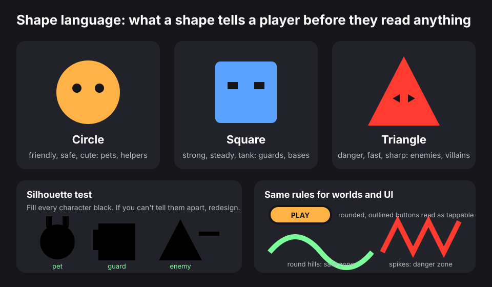

# Shape language

A player reads a shape before any text. Use that to say "friend", "tough" or "danger" without words.

## Do this
- Give each character one base shape: circle for friendly and cute, square for strong and steady, triangle for fast or dangerous.
- Fill every character, pet and enemy solid black. If two look alike, change the outline (ears, horns, hats, weapons), not the colour.
- Make the shape readable at 40 px. Roblox players see most things small on a phone.
- Use the same rule for places: round, soft terrain for safe areas; sharp rocks, spikes and thin towers for danger.
- Use one danger colour across the whole game and never on safe things (Tower of Hell: red neon kills).
- Buttons for kids: rounded rectangles with a thick dark outline and a bright fill (Adopt Me, Brawl Stars).

## Examples in hit games
- Circle: Adopt Me pets (oversized round heads), Kirby, Fall Guys beans, Among Us crewmates.
- Square: Deep Rock Galactic dwarves, Minecraft, Overwatch tanks.
- Triangle: Hornet in Silksong, Rainbow Friends' Green (long sharp limbs), spiky boss shapes.
- One idea per character: Celeste's hair shows dash state; Pikmin colour equals ability; Blox Fruits' powers each own one colour.

## Where to look next
- [[16-Market-Research/visual-refs-roblox-simulators]], [[16-Market-Research/visual-refs-roblox-social]], [[16-Market-Research/visual-refs-roblox-action]]
- [[16-Market-Research/visual-refs-mobile]], [[16-Market-Research/visual-refs-nintendo]], [[16-Market-Research/visual-refs-big-3d]], [[16-Market-Research/visual-refs-pc-indie]]
- [[10-Art-Environment/art-direction-for-roblox]] and [[10-Art-Environment/npc-and-character-design]]
